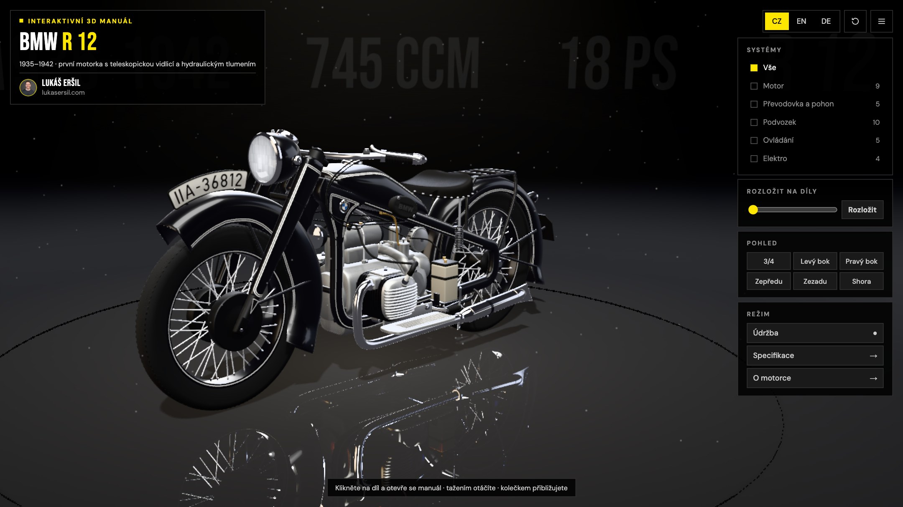
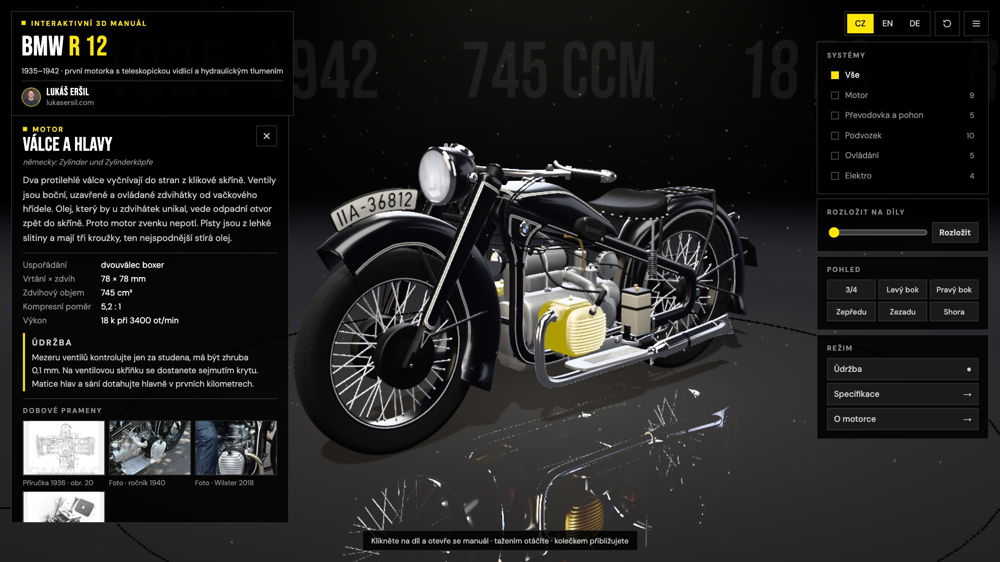
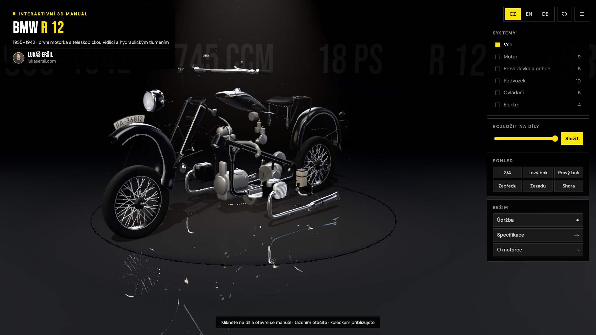

# BMW R 12 · interaktivní 3D manuál

> **Neoficiální fanouškovský projekt.** Nevznikl ve spolupráci s BMW AG ani BMW Group Classic a není to oficiální dokumentace BMW. BMW a logo BMW jsou ochranné známky BMW AG. Je to ukázka toho, co dnes jde udělat s AI: model, kód i texty vznikly s pomocí AI (Claude) podle dobových pramenů.
>
> **Unofficial fan project.** Not made with or endorsed by BMW AG or BMW Group Classic, and not official BMW documentation. BMW and the BMW logo are trademarks of BMW AG. A showcase of what can be done with AI today: the model, code and texts were made with AI (Claude) from period sources.

Interaktivní 3D model civilní BMW R 12 (1935–1942, jeden karburátor SUM) a k ní manuál v prohlížeči: otáčení, přiblížení, rozložení na díly, karta ke každému dílu s popisem, technickými údaji a údržbou z dobové příručky, mazací plán přímo na motorce, dobové obrázky a fotky dochovaných strojů. Česky, anglicky a německy.

Udělal jsem ho pro svou vlastní R12, protože návod v češtině, jak se o ni starat, neexistuje.



| Karta dílu | Rozložená motorka |
|---|---|
|  |  |

- **Online:** https://claude.ai/artifact/HgGB1GGvW22W6YeGh2Mwma
- **Video:** [video/bmw-r12-3d-manual-demo.mp4](video/bmw-r12-3d-manual-demo.mp4) (bez hudby)
- **Autor:** [Lukáš Eršil](https://lukasersil.com)

## Spuštění

Stránka používá ES moduly a načítá model ze souboru, takže potřebuje lokální server (z `file://` nepoběží):

```bash
python3 -m http.server 8000
```

Pak otevři http://localhost:8000. Three.js a písma se načítají z CDN, zbytek je v repu.

## Co je kde

| Cesta | Obsah |
|---|---|
| `index.html` | stránka, styly, rozvržení |
| `src/` | aplikace: scéna, výběr dílů, karty, intro (`main.js`, `ui.js`, `look.js`, `stage.js`, `intro.js`) |
| `src/data/` | texty dílů, mazací plán a specifikace (`content.js` CZ/EN, `de.js` němčina), dobové obrázky (`media.js`), texty rozhraní |
| `scene/r12.txt` | model motorky (Draco GLB v base64), `scene/logo.txt` logo v intru |
| `model/r12.glb` | stejný model jako obyčejný GLB pro Blender, three.js a další nástroje |
| `blender/build_r12.py` | celý model postavený kódem v Blenderu (díly, tvary, materiály, rozložení) |
| `blender/r12_scene.blend` | scéna s kamerou podle dobové fotky na porovnání |
| `media/` | dobové obrázky a fotky na kartách dílů (viz [CREDITS.md](CREDITS.md)) |
| `tools/` | výřezy obrázků, nahrávání videa, export do tohohle repa |

## Úpravy modelu

Model se generuje skriptem, žádné ruční modelování. Testováno v Blenderu 5.2:

```bash
Blender -b -P blender/build_r12.py -- blender/out --glb
base64 -i blender/out/r12.glb | tr -d '\n' > scene/r12.txt
```

Každý díl je pojmenovaný objekt s id dílu, systémem a směrem rozložení. Rozměry jsou v metrech, osa x dopředu, y nahoru, z doprava. U většiny tvarů je v komentáři, z jakého pramene je změřený (obrázek v příručce, tabule v seznamu dílů, fotka).

Texty dílů upravíš v `src/data/content.js` (čeština, angličtina) a `src/data/de.js` (němčina).

## Prameny

- Instruction Book R 12 / R 17, BMW, Mnichov 1936 (sken BMW Group Archive) a německá příručka R 12 / R 17
- Ersatzteilliste für BMW Krafträder R 12 / R 17, březen 1938 (tabule dílů)
- Fact sheet BMW R 12, BMW Group Archive
- Fotky dochovaných strojů z Wikimedia Commons, autoři a licence v [CREDITS.md](CREDITS.md)

Čísla v textech jsou fakta s odkazem na stranu pramene, popisy jsou vlastními slovy.

## Licence

- **Kód** (`src/`, `tools/`, `blender/*.py`, `index.html`): [MIT](LICENSE)
- **3D model a texty** (`scene/`, `model/`, `blender/r12_scene.blend`, `blender/textures/`, `src/data/`): [CC BY 4.0](LICENSE-ASSETS.md), uveď autora: Lukáš Eršil, lukasersil.com
- **Cizí obsah** (dobové skeny, fotky z Commons, logo BMW, fotka autora) pod tyhle licence **nespadá**, podmínky jsou v [CREDITS.md](CREDITS.md).

Klidně si to stáhni, uprav a postav na tom vlastní věc. Budu rád za odkaz.

---

## English

An interactive 3D model of the civilian BMW R 12 (1935–1942, single SUM carburettor) with a browser manual: rotate, zoom, explode into parts, a card for every part with its description, technical data and maintenance from the period handbook, the lubrication chart on the bike, period figures and photos of surviving machines. Czech, English and German.

I made it for my own R12, because there is no manual in Czech on how to look after it.

**Run it:** `python3 -m http.server 8000` in the repo folder, then open http://localhost:8000 (ES modules need a server).

**Change the model:** it is built entirely by `blender/build_r12.py` (tested on Blender 5.2): `Blender -b -P blender/build_r12.py -- blender/out --glb`, then base64 the GLB into `scene/r12.txt`. A plain GLB is in `model/r12.glb`.

**Licence:** code under [MIT](LICENSE), 3D model and texts under [CC BY 4.0](LICENSE-ASSETS.md) (credit: Lukáš Eršil, lukasersil.com). Third-party material (period scans, Commons photos, the BMW logo, the author's photo) is not covered, see [CREDITS.md](CREDITS.md).
